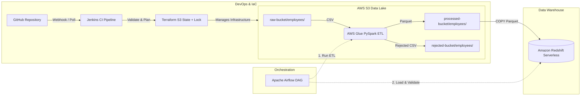

# Employee Data Platform: End-to-End AWS Data Pipeline

An enterprise-grade, end-to-end cloud data pipeline engineered with **AWS (S3, Glue, Redshift Serverless)**, orchestrated with **Apache Airflow**, provisioned via **Terraform (IaC)**, and continuously validated through **Jenkins CI/CD**.

---

## 🏛 Architecture Overview



---

## 📁 Repository Structure

```text
employee_data_pipeline/
├── .github/                      # Version control metadata
├── config/                       # Airflow configuration (airflow.cfg)
├── dags/                         # Airflow DAG definitions
│   └── employee_data_pipeline.py # Main orchestration DAG
├── jenkins-compose.yaml          # Jenkins LTS container definition with Terraform
├── docker-compose.yaml           # Local Apache Airflow & Celery cluster
├── Jenkinsfile                   # Declarative Jenkins CI pipeline
├── scripts/
│   └── glue/
│       └── employee-data-etl.py  # PySpark ETL script for AWS Glue
├── sql/
│   └── redshift_schema.sql       # Redshift DDL, staging tables, and audit queries
├── terraform/
│   ├── .terraform.lock.hcl       # Provider dependency lock
│   ├── main.tf                   # Backend (S3 + use_lockfile) and AWS Provider
│   └── s3.tf                     # S3 bucket resource definitions
├── .env                          # Local environment settings (git-ignored)
├── .gitignore                    # Git ignore rules for state, secrets, and caches
└── README.md                     # Comprehensive project documentation
```

---

## 🚀 Key Pipeline Components

### 1. Storage Layer (Amazon S3)
- **Bucket**: `employee-data-platform-sai-2026` (Region: `ap-southeast-2`)
- **Folder Topology**:
  - `raw-bucket/employees/`: Ingestion landing zone for raw employee CSV datasets.
  - `processed-bucket/employees/`: Cleaned, typed, deduplicated Parquet files.
  - `rejected-bucket/employees/`: Failed validation records quarantined for audit.
  - `scripts/`: Glue job code and automation scripts.
  - `athena-results/`: Query cache and export outputs.

### 2. ETL Processing (AWS Glue 5.1 + Apache Spark)
- **Job Name**: `employee-data-etl`
- **Engine**: Apache Spark 3.x (Python 3, Glue 5.1 runtime, 2x G.1X workers).
- **Processing Logic**:
  1. Ingests raw CSV and infers/verifies types.
  2. Deduplicates records on `employee_id`.
  3. Validates email formats using regex (`^[A-Za-z0-9._%+-]+@[A-Za-z0-9.-]+\.[A-Za-z]{2,}$`).
  4. Enforces data quality rules (non-null IDs, positive salaries, valid joining dates).
  5. Splits valid records into Snappy-compressed Parquet and writes rejected records into the audit partition.

### 3. Data Warehouse (Amazon Redshift Serverless)
- **Namespace**: `employee-data-namespace`
- **Workgroup**: `employee-data-workgroup`
- **Database**: `dev` | **Table**: `public.employees`
- **Verified Record Count**: 2,149 clean records (0 null IDs, 0 null emails, 0 negative/zero salaries).

### 4. Workflow Orchestration (Apache Airflow)
- **DAG ID**: `employee_data_pipeline`
- **Task Sequence**:
  $$\text{run\_glue\_etl} \longrightarrow \text{clear\_redshift} \longrightarrow \text{load\_redshift} \longrightarrow \text{validate\_redshift}$$
- **Connection**: `aws_default` configured with AWS IAM execution privileges.

### 5. Infrastructure as Code (Terraform)
- **Provider**: AWS Provider `~> 6.0`
- **Remote State**: S3 Backend (`employee-data-platform-sai-terraform-state-2026`)
- **State Locking**: S3 native lockfile (`use_lockfile = true`)
- **Clean Git Workflow**: State files (`*.tfstate`) and runtime directories are excluded via `.gitignore` to prevent secret leaks and concurrency collisions.

### 6. Continuous Integration (Jenkins CI)
- **Deployment**: Containerized Jenkins LTS running in Docker (`employee-jenkins`).
- **Pipeline Stages**:
  1. **Checkout**: Pulls latest commit from GitHub `main` branch.
  2. **Terraform Validate & Plan**: Uses Jenkins credentials `aws-terraform-credentials` to run `terraform init`, `terraform validate`, and `terraform plan`.
- **Security**: The dedicated IAM user `jenkins-terraform-user` is restricted via least-privilege policy (`JenkinsTerraformS3Access`) to state and data buckets only.

---

## 🛠 Setup & Execution Runbook

### Prerequisites
- Docker & Docker Compose
- AWS CLI v2 configured with appropriate credentials
- Terraform `>= 1.5.0`

### 1. Terraform Local Verification
```bash
cd terraform
terraform init
terraform validate
terraform plan
```

### 2. Running Airflow Locally
```bash
# Start the Airflow Celery cluster
docker compose up -d

# Check status
docker compose ps
```
Airflow Web UI: [http://localhost:8080](http://localhost:8080) (Default user: `airflow` / `airflow`)

### 3. Running Jenkins CI
```bash
# Start Jenkins service
docker compose -f jenkins-compose.yaml up -d
```
Jenkins Web UI: [http://localhost:8081](http://localhost:8081)

---

## 🛡 Production Best Practices & Hardening

### Safe Redshift Staging Pattern (Failure Recovery)
In production, running `DELETE FROM public.employees;` directly before `COPY` risks leaving the table empty if the COPY step fails. The recommended pattern is an **Atomic Swap** using a staging table:

```sql
-- 1. Load data to staging table
COPY public.employees_staging
FROM 's3://employee-data-platform-sai-2026/processed-bucket/employees/'
IAM_ROLE 'arn:aws:iam::682595228520:role/RedshiftEmployeeDataRole'
FORMAT AS PARQUET;

-- 2. Atomic swap inside a transaction
BEGIN TRANSACTION;
TRUNCATE TABLE public.employees;
INSERT INTO public.employees SELECT * FROM public.employees_staging;
COMMIT;
```

### IAM Least Privilege Configuration
The CI IAM user `jenkins-terraform-user` has no broad AWS administrative permissions. Its inline policy is scoped only to:
1. `employee-data-platform-sai-terraform-state-2026` (state lock & read/write)
2. `employee-data-platform-sai-2026` (data lake bucket management)

---

## 📊 Data Quality & Verification Queries

Run in the Redshift Query Editor or via AWS CLI:

```sql
-- Check total records and verify data quality constraints
SELECT 
    COUNT(*) AS total_records,
    COUNT(CASE WHEN employee_id IS NULL THEN 1 END) AS missing_ids,
    COUNT(CASE WHEN email IS NULL THEN 1 END) AS missing_emails,
    COUNT(CASE WHEN salary IS NULL OR salary <= 0 THEN 1 END) AS invalid_salaries
FROM public.employees;
```
Expected Output:
| total_records | missing_ids | missing_emails | invalid_salaries |
| :--- | :--- | :--- | :--- |
| **2149** | **0** | **0** | **0** |
